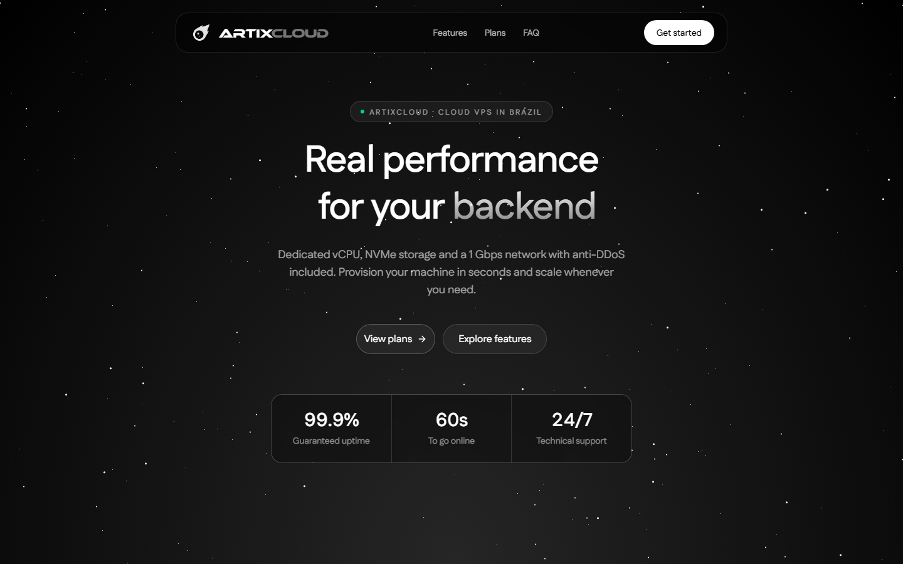

<h1 align="center">ArtixCloud</h1>

<p align="center">
  <b>A hosting platform in one repository: a web dashboard, a Rust API and a container agent that sell and run VPS and containers on Proxmox and Docker.</b>
</p>

<p align="center">
  
  
  
  <a href="https://github.com/q6r/artix/actions/workflows/ci.yml"></a>
</p>

<p align="center">English · <a href="README.pt-BR.md">Português</a></p>

<p align="center"></p>

This is the source of [ArtixCloud](https://artix.cloud). Customers pick a plan, pay with PIX, card or crypto, and manage
their servers from a dashboard: power controls, live metrics, a console in the browser, files, backups, domains and
support. The code is public so you can read it and learn from it. Several pieces are tied to that service (a Brazilian
PIX provider, the `artix.cloud` domain, a Portuguese-first interface), and nothing here is packaged as a turnkey
self-hosted product: running your own copy means bringing a Proxmox cluster, a Docker VM, MongoDB and the third-party
accounts listed in [docs/configuration.md](docs/configuration.md).

## Features

**VPS on Proxmox**

- Create a server from an OS template with cloud-init, then start, stop, reboot or shut it down.
- Live CPU, memory, network and disk graphs.
- A console in the browser: the VGA screen through noVNC and a serial terminal through xterm.js.
- A file manager and a command runner through the guest agent, disk usage, root password reset and reinstall onto a
  different OS.
- Paid RAM and disk upgrades, a dedicated IP add-on, and public SSH for servers behind NAT through frp relays.

**Containers on a Docker VM**

- Four types: Discord bots, sites, Minecraft servers (Java and Bedrock) and Mumble voice servers.
- Sites: upload a zip with a small `.artix` file (Node and Python runtimes), deploy from a GitHub repository with push
  webhooks, get `<name>.artix.cloud` or attach your own domain.
- Minecraft: console, settings, backups, and a world uploaded as a file or restored from a URL, with DNS records written
  through Cloudflare so players connect by name.
- A free quota per account and a global cap.

**Billing**

- Plans, subscriptions, invoices, renewals and suspension after a grace period, driven by an idempotent in-process worker.
- PIX through PagCI, cards through Stripe Checkout and Litecoin through eupa. Webhooks are verified by signature.

**Accounts and operations**

- Email and password (Argon2id), passwordless login codes, backup codes, Discord and GitHub sign-in, and a list of
  sessions you can revoke.
- Developer API keys with scopes, a small key-authenticated API under `/v1`, organizations with members, support tickets,
  live notifications over a WebSocket and announcements.
- A shared community voice room that runs in the browser.
- An admin panel with role-based permissions, an audit log and a security-event log.
- The interface is available in Portuguese (default), English and Spanish. There are also a blog, docs, a status page and
  the legal pages.

## Quick start

You need Node.js 22 or newer, a recent Rust toolchain (1.88+) and MongoDB 7. Docker is the easiest way to get MongoDB.

```bash
git clone https://github.com/q6r/artix.git
cd artix

# 1. The API
cp backend/.env.example backend/.env       # then set AUTH_TOKEN_SECRET and AUTH_REFRESH_PEPPER (openssl rand -hex 32)
docker compose -f backend/docker-compose.dev.yml up -d mongo
cd backend && cargo run                    # http://localhost:8080/health

# 2. The web app, in another terminal
npm ci
cp .env.example .env.local
npm run dev                                # http://localhost:3000
```

Everything that talks to the outside (Proxmox, payments, email, DNS, voice) is optional: an integration that is not
configured is switched off and its endpoints answer `503`. Without a Resend key the API prints each email, including
login codes, to its log instead of sending it.

To check a configuration without starting the server, run `cargo run -- --check-config` in `backend/`. It reports every
problem at once, lists which integrations are enabled and warns about half-configured ones.

**The first admin.** Nobody is an admin by default. The API creates a `super_admin` role at startup; give it to a user you
registered, with `mongosh`:

```js
// mongosh mongodb://localhost:27017/artixcloud
const role = db.roles.findOne({ name: "super_admin" });
db.users.updateOne({ email: "you@example.com" }, { $addToSet: { role_ids: role._id } });
```

## How it fits together

```
 Browser ──► Next.js: pages + route handlers (BFF) ──► Rust API (Axum) ──► MongoDB
   │         session tokens stay in httpOnly cookies        │
   │                                                        ├──► Proxmox VE: VPS lifecycle, metrics, console
   └──► WebSocket gateway of the API (short-lived ticket)   ├──► container agent on the Docker VM
                                                            ├──► PagCI, Stripe, eupa: payments
                                                            └──► Resend, Cloudflare, LiveKit, frp relays
```

- **Web app** (`app/`, `components/`, `lib/`). Next.js 16 with React 19 and Tailwind 4. The route handlers in `app/api`
  are a backend-for-frontend: they attach the access token from an httpOnly cookie, refresh it once on a `401`, block
  cross-site writes, and stream the answer back. `proxy.ts` only gates `/dashboard` on the presence of a session cookie;
  every real authorization decision happens in the API.
- **API** (`backend/`). Rust with Axum and MongoDB. Handlers only shape HTTP; authentication is an extractor, and every
  protected action checks one permission. Roles carry permissions with `*` and `prefix.*` wildcards, and there is no
  `is_admin` flag. [backend/README.md](backend/README.md) explains the auth design, the collections and the routes.
- **Container agent** (`container-agent/`). A small Express service on the Docker VM. The API is its only client: it
  authenticates with a bearer token and refuses to start without one. It builds and runs the user containers through the
  local Docker daemon.

## Configuration

Three components, three templates: [`backend/.env.example`](backend/.env.example) for the API,
[`.env.example`](.env.example) for the web app and [`container-agent/.env.example`](container-agent/.env.example) for the
agent. [docs/configuration.md](docs/configuration.md) lists every variable with its default and says whether it is a
secret. A blank value counts as unset, booleans are exactly `true` or `false`, and the real environment wins over a
`.env` file. The API refuses to start on an invalid configuration and prints all the problems together.

## Project layout

```
app/               Next.js routes: marketing pages, the dashboard, and the BFF route handlers (app/api)
components/        React components: shadcn/ui, Animate UI and the dashboard widgets
lib/               API helpers for the BFF, translations (pt, en, es), env access, the WebSocket client
hooks/             React hooks
backend/           The Rust API: src/, tests/, Dockerfile and a development docker-compose.yml
container-agent/   The Node service that runs on the Docker VM
docs/              The configuration reference and the README screenshots
public/            Static assets
```

## Security notes

- Access tokens are HMAC-SHA256 and the algorithm is fixed in code, so there is no `alg` header to confuse. Every request
  also loads the session, so revoking a session takes effect immediately.
- Refresh tokens are opaque and stored only as a peppered hash. They rotate on every use, and presenting an old one
  revokes the whole session, because that means it was stolen.
- Passwords use Argon2id. Login runs a dummy verification for unknown accounts, and repeated failures lock the account
  for a while.
- Session tokens never reach JavaScript. Cookies are `httpOnly` and `Secure`, cross-site writes are rejected, the
  WebSocket uses a short-lived ticket, and the rate limiter keys on the address Cloudflare reports rather than on a
  header the client controls.
- Payment webhooks are checked with a constant-time signature comparison and a replay window.
- Secrets come from the environment only. The code has none, and the API refuses weak secrets in production.

Found a vulnerability? Please follow [SECURITY.md](SECURITY.md) instead of opening a public issue.

## Testing

```bash
npm run lint && npm run build            # web: lint, then a production build, which also type-checks
cd backend
cargo fmt --check && cargo clippy --all-targets
cargo test                               # unit tests, and the config tests
MONGO_TEST_URI=mongodb://localhost:27017 cargo test   # also runs the integration tests against a real database
```

The integration tests drive the real router and cover token rotation and reuse, instant revocation, access to other
people's resources, role checks, rate limits and billing settlement. Without `MONGO_TEST_URI` they skip. CI runs all of
this, plus a syntax check of the container agent and a build of the API image.

## Contributing

Issues and pull requests are welcome. [CONTRIBUTING.md](CONTRIBUTING.md) covers the setup, the checks and the commit style.

## Credits

Built with [Next.js](https://nextjs.org), [Axum](https://github.com/tokio-rs/axum) and [MongoDB](https://www.mongodb.com).
The interface uses components from [shadcn/ui](https://ui.shadcn.com) and [Animate UI](https://animate-ui.com), the
browser console uses [noVNC](https://novnc.com) and [xterm.js](https://xtermjs.org), and the community voice room uses
[LiveKit](https://livekit.io). None of them is affiliated with this project.
