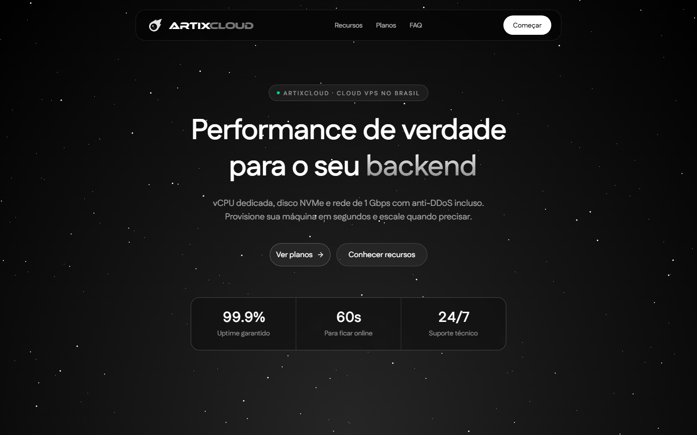

<h1 align="center">ArtixCloud</h1>

<p align="center">
  <b>Uma plataforma de hospedagem em um único repositório: um painel web, uma API em Rust e um agente de containers que vendem e executam VPS e containers em Proxmox e Docker.</b>
</p>

<p align="center">
  
  
  
  <a href="https://github.com/q6r/artix/actions/workflows/ci.yml"></a>
</p>

<p align="center"><a href="README.md">English</a> · Português</p>

<p align="center"></p>

Este é o código-fonte da [ArtixCloud](https://artix.cloud). O cliente escolhe um plano, paga com PIX, cartão ou cripto e
gerencia os servidores num painel: controle de energia, métricas ao vivo, console no navegador, arquivos, backups,
domínios e suporte. O código é público para você ler e aprender com ele. Várias peças são específicas desse serviço (um
provedor de PIX brasileiro, o domínio `artix.cloud`, uma interface que começa em português), e nada aqui vem empacotado
como um produto pronto para auto-hospedar: rodar a sua própria cópia exige um cluster Proxmox, uma VM com Docker, o
MongoDB e as contas de terceiros listadas em [docs/configuration.md](docs/configuration.md) (em inglês).

## Recursos

**VPS no Proxmox**

- Crie um servidor a partir de um template de sistema com cloud-init e depois ligue, desligue, reinicie ou finalize.
- Gráficos ao vivo de CPU, memória, rede e disco.
- Console no navegador: a tela VGA pelo noVNC e um terminal serial pelo xterm.js.
- Gerenciador de arquivos e execução de comandos pelo agente convidado, uso de disco, redefinição da senha de root e
  reinstalação com outro sistema.
- Upgrades pagos de RAM e disco, IP dedicado como adicional e SSH público para servidores atrás de NAT por relays frp.

**Containers numa VM com Docker**

- Quatro tipos: bots de Discord, sites, servidores de Minecraft (Java e Bedrock) e servidores de voz Mumble.
- Sites: envie um zip com um pequeno arquivo `.artix` (runtimes Node e Python), publique a partir de um repositório do
  GitHub com webhooks de push, receba `<nome>.artix.cloud` ou use um domínio seu.
- Minecraft: console, configurações, backups, e um mundo enviado como arquivo ou restaurado de uma URL, com registros DNS
  criados pela Cloudflare para os jogadores entrarem pelo nome.
- Uma cota gratuita por conta e um teto global.

**Cobrança**

- Planos, assinaturas, faturas, renovações e suspensão depois de um prazo de carência, conduzidos por um worker
  idempotente dentro do processo.
- PIX pela PagCI, cartão pelo Stripe Checkout e Litecoin pela eupa. Os webhooks são verificados por assinatura.

**Contas e operação**

- E-mail e senha (Argon2id), códigos de login sem senha, códigos de backup, login com Discord e GitHub e uma lista de
  sessões que você pode revogar.
- Chaves de API para desenvolvedores com escopos, uma pequena API autenticada por chave em `/v1`, organizações com
  membros, tickets de suporte, notificações ao vivo por WebSocket e avisos.
- Uma sala de voz da comunidade, compartilhada, que roda no navegador.
- Um painel de administração com permissões por papel, log de auditoria e log de eventos de segurança.
- A interface existe em português (padrão), inglês e espanhol. Há ainda blog, documentação, página de status e as
  páginas legais.

## Início rápido

Você precisa do Node.js 22 ou mais novo, de um toolchain Rust recente (1.88+) e do MongoDB 7. O jeito mais simples de ter
o MongoDB é com Docker.

```bash
git clone https://github.com/q6r/artix.git
cd artix

# 1. A API
cp backend/.env.example backend/.env       # depois defina AUTH_TOKEN_SECRET e AUTH_REFRESH_PEPPER (openssl rand -hex 32)
docker compose -f backend/docker-compose.dev.yml up -d mongo
cd backend && cargo run                    # http://localhost:8080/health

# 2. O app web, em outro terminal
npm ci
cp .env.example .env.local
npm run dev                                # http://localhost:3000
```

Tudo o que conversa com o mundo de fora (Proxmox, pagamentos, e-mail, DNS, voz) é opcional: uma integração não
configurada fica desligada e os endpoints dela respondem `503`. Sem uma chave do Resend, a API escreve cada e-mail, com
os códigos de login, no próprio log em vez de enviar.

Para conferir uma configuração sem subir o servidor, rode `cargo run -- --check-config` em `backend/`. Ele mostra todos
os problemas de uma vez, lista quais integrações estão ligadas e avisa sobre as que ficaram pela metade.

**O primeiro admin.** Ninguém é admin por padrão. A API cria o papel `super_admin` ao iniciar; dê esse papel a um usuário
que você cadastrou, com o `mongosh`:

```js
// mongosh mongodb://localhost:27017/artixcloud
const role = db.roles.findOne({ name: "super_admin" });
db.users.updateOne({ email: "voce@exemplo.com" }, { $addToSet: { role_ids: role._id } });
```

## Como as peças se encaixam

```
 Navegador ──► Next.js: páginas + route handlers (BFF) ──► API Rust (Axum) ──► MongoDB
   │           tokens de sessão ficam em cookies httpOnly      │
   │                                                           ├──► Proxmox VE: ciclo de vida das VPS, métricas, console
   └──► gateway WebSocket da API (ticket de curta duração)     ├──► agente de containers na VM com Docker
                                                               ├──► PagCI, Stripe, eupa: pagamentos
                                                               └──► Resend, Cloudflare, LiveKit, relays frp
```

- **App web** (`app/`, `components/`, `lib/`). Next.js 16 com React 19 e Tailwind 4. Os route handlers de `app/api` são um
  backend-for-frontend: anexam o token de acesso que vem de um cookie httpOnly, renovam uma vez em caso de `401`,
  bloqueiam escritas vindas de outro site e devolvem a resposta em stream. O `proxy.ts` só barra `/dashboard` quando não
  há cookie de sessão; toda decisão real de autorização acontece na API.
- **API** (`backend/`). Rust com Axum e MongoDB. Os handlers só cuidam da forma do HTTP; a autenticação é um extractor e
  toda ação protegida confere uma permissão. Os papéis carregam permissões com curingas `*` e `prefixo.*`, e não existe
  flag `is_admin`. O [backend/README.md](backend/README.md) (em inglês) explica o desenho da autenticação, as coleções e
  as rotas.
- **Agente de containers** (`container-agent/`). Um pequeno serviço Express na VM com Docker. A API é o único cliente: ele
  autentica por um token bearer e se recusa a iniciar sem um. Constrói e executa os containers dos usuários pelo daemon
  Docker local.

## Configuração

São três componentes e três modelos: [`backend/.env.example`](backend/.env.example) para a API,
[`.env.example`](.env.example) para o app web e [`container-agent/.env.example`](container-agent/.env.example) para o
agente. O [docs/configuration.md](docs/configuration.md) lista cada variável com o valor padrão e diz se ela é um segredo.
Um valor em branco conta como não definido, booleanos são exatamente `true` ou `false` e o ambiente real vence o arquivo
`.env`. A API se recusa a iniciar com uma configuração inválida e mostra todos os problemas juntos.

## Estrutura do projeto

```
app/               Rotas do Next.js: páginas públicas, o painel e os route handlers do BFF (app/api)
components/        Componentes React: shadcn/ui, Animate UI e os widgets do painel
lib/               Ajudantes de API para o BFF, traduções (pt, en, es), acesso ao ambiente, cliente WebSocket
hooks/             Hooks do React
backend/           A API em Rust: src/, tests/, Dockerfile e um docker-compose.yml de desenvolvimento
container-agent/   O serviço Node que roda na VM com Docker
docs/              A referência de configuração e as imagens do README
public/            Arquivos estáticos
```

## Notas de segurança

- Os tokens de acesso usam HMAC-SHA256 e o algoritmo é fixo no código, então não existe cabeçalho `alg` para confundir.
  Toda requisição também carrega a sessão, então revogar uma sessão vale na hora.
- Os tokens de renovação são opacos e guardados só como hash com pepper. Eles rodam a cada uso, e apresentar um antigo
  revoga a sessão inteira, porque isso significa que ele foi roubado.
- As senhas usam Argon2id. O login faz uma verificação falsa para contas que não existem, e falhas repetidas bloqueiam a
  conta por um tempo.
- Os tokens de sessão nunca chegam ao JavaScript. Os cookies são `httpOnly` e `Secure`, escritas de outro site são
  rejeitadas, o WebSocket usa um ticket de curta duração e o limitador de taxa usa o endereço informado pela Cloudflare,
  não um cabeçalho que o cliente controla.
- Os webhooks de pagamento são conferidos com comparação de assinatura em tempo constante e uma janela contra replay.
- Os segredos vêm só do ambiente. O código não tem nenhum, e a API recusa segredos fracos em produção.

Encontrou uma vulnerabilidade? Siga o [SECURITY.md](SECURITY.md) em vez de abrir uma issue pública.

## Testes

```bash
npm run lint && npm run build            # web: lint e depois um build de produção, que também confere os tipos
cd backend
cargo fmt --check && cargo clippy --all-targets
cargo test                               # testes unitários e os de configuração
MONGO_TEST_URI=mongodb://localhost:27017 cargo test   # roda também os de integração contra um banco de verdade
```

Os testes de integração usam o router de verdade e cobrem rotação e reuso de tokens, revogação imediata, acesso a
recursos de outras pessoas, checagem de papéis, limites de taxa e liquidação de cobranças. Sem `MONGO_TEST_URI` eles são
pulados. O CI roda tudo isso, mais uma checagem de sintaxe do agente de containers e o build da imagem da API.

## Contribuindo

Issues e pull requests são bem-vindos. O [CONTRIBUTING.md](CONTRIBUTING.md) (em inglês) cobre o ambiente, as checagens e
o estilo dos commits.

## Créditos

Feito com [Next.js](https://nextjs.org), [Axum](https://github.com/tokio-rs/axum) e [MongoDB](https://www.mongodb.com).
A interface usa componentes do [shadcn/ui](https://ui.shadcn.com) e do [Animate UI](https://animate-ui.com), o console do
navegador usa [noVNC](https://novnc.com) e [xterm.js](https://xtermjs.org), e a sala de voz da comunidade usa o
[LiveKit](https://livekit.io). Nenhum deles é afiliado a este projeto.
